# Sistema Web de Gestión para Gimnasios ForgeFit — Borrador

> Fuente: Sistema Web de Gestión para Gimnasios ForgeFit - Borrador.docx. Transcripción a Markdown del contenido del documento, conservando sus textos, tablas e imágenes incrustadas. Se omiten espacios y saltos de página de maquetación; el índice conserva la paginación original. Los marcadores pendientes del borrador se mantienen como contenido, no como tareas ejecutadas. Las figuras conservan sus archivos originales; no se reconstruyen formas nativas de Word.

## SISTEMA WEB DE GESTIÓN PARA GIMNASIOS

## FORGE FIT

Integrante: Christian Gigena

Año: 2026

ÍNDICE 

- Introducción ........................................................................................................................................3

- Carta de Presentación .....................................................................................................................4

- Pedido del Usuario ...........................................................................................................................5

- Relevamiento del Negocio .............................................................................................................6  4.1 Datos de la Empresa ..................................................................................................................6  4.2 Distribución Física del Gimnasio ………………………………………………………………………….…...6  4.3 Historia de la Empresa ..............................................................................................................7  4.4 Misión, Visión y Objetivos ........................................................................................................7  4.5 Mercado .......................................................................................................................................8  4.6 Servicios Ofrecidos ………………………........................................................................................8  4.7 Clientes …......................................................................................................................................8  4.8 Proveedores …………………………………….....................................................................................8  4.9 Competidores ...........................................................................................................................................8  4.10 Dimensionamiento …................................................................................................................................8

- Relevamiento Estructural ….................................................................................................................................9  5.1 Organigrama …..............................................................................................................................................10  5.2 Descripción de las Áreas …..................................................................................................................10  5.3 Estructura Organizacional ...................................................................................................................11  5.4 Relación entre Áreas……………..................................................................................................................12

- Relevamiento Funcional ...................................................................................................................................13  6.1 Introducción al Relevamiento Funcional …................................................................................13  6.2 Proceso de Alta de Socios .................................................................................................................13  6.3 Proceso de Gestión de Pagos ..........................................................................................................14  6.4 Proceso de Registro de Asistencia……..........................................................................................15  6.5 Conclusión del Relevamiento Funcional ..................................................................................16

- Relevamiento Tecnológico …………………………….............................................................................................17  7.1 Hardware ………………………….………………………................................................................................................17  7.2 Conectividad …………………..………………………...............................................................................................18  7.3 Software Utilizado …………..……………………….............................................................................................19  7.4 Problemáticas Detectadas ..……………………........................................................................................19  7.5 Tecnología Aplicable ………..….…………………............................................................................................19  7.6 Beneficios Esperados ……...….…………………............................................................................................19  7.7 Conclusión del Relevamiento Tecnológico …...........................................................................20

- Diagnóstico y Propuesta …...............................................................................................................................21  8.1 Cuadro Comparativo Diagnóstico / Propuesta …................................................................21  8.2 Conclusión del Diagnóstico ………………………………............................................................................22

- Propuesta General ………………….………………........................................................................................................23

- Modelo de Requerimientos y Ambiental

- Ingeniería de Requerimientos……………….………………………………………………………….…………….99

- Requerimientos funcionales y no funcionales……………….……………………………………….99

- UML……………….………………………………………………………….…………….99

- Casos de Uso……………….………………………………………………………….…………….99

- Actores……………….………………………………………………………….…………….99

- Relaciones entre Casos de Uso……………….………………………………………………………….………….99

- Paquetes……………….………………………………………………………….99

- Diagrama de Clases……………….………………………………………………………….…………….99

- Diagrama de Estados……………….………………………………………………………….…………….99

- Diagrama de Colaboración……………….………………………………………………………….…………….99

- Prototipos de Interfaz……………….………………………………………………………….…………….99

- Modelo de Caso de Uso Ambiental

- Definición de Objetivos……………….………………………………………………………….…………….99

- Límites……………….………………………………………………………….…………….99

- Alcance……………….………………………………………………………….…………….99

- Lista de Requerimientos……………….………………………………………………………….…………….99

- Modelo de Paquetes

- Descripción de Actores……………….………………………………………………………….…………….99

- Diagrama de Caso de Uso Ambiental……………….………………………………………….…………….99

- Modelo de Paquetes ........................................................................................................ 99

- Árbol de Casos de Uso .................................................................................................. 99

- Desarrollo del Paquete “Registro de Asistencia” ..................................................... 99

- Anexos ................................................................................................................................ 99

- Glosario .............................................................................................................................. 99

## INTRODUCCIÓN

El presente informe corresponde al Proyecto de Trabajo Final de la carrera Analista de Sistemas del Instituto IES Siglo 21, desarrollado en el marco de la materia Práctica Profesionalizante II.

El objetivo principal del proyecto consiste en realizar el relevamiento, análisis y propuesta de una solución informática orientada a optimizar la gestión administrativa y operativa de un gimnasio, mediante el desarrollo del sistema denominado  ForgeFit .

Durante esta etapa se lleva a cabo el relevamiento organizacional, estructural y funcional de la empresa, permitiendo identificar sus procesos de negocio, necesidades actuales, problemáticas existentes y oportunidades de mejora.

La información obtenida servirá como base para el posterior análisis, diseño y desarrollo de una solución tecnológica capaz de centralizar la información, automatizar procesos y mejorar la eficiencia operativa de la organización.

## CARTA DE PRESENTACIÓN

### La Cumbre, Córdoba – 2026

### A quien corresponda:

### Me dirijo a usted en calidad de alumno de la carrera Analista de Sistemas del Instituto IES Siglo 21, con el objetivo de presentar formalmente el Proyecto de Trabajo Final correspondiente a la materia Práctica Profesionalizante II.

### El presente trabajo tiene como finalidad realizar el relevamiento, análisis y propuesta de una solución informática destinada a optimizar los procesos administrativos y operativos de la organización.

### Agradezco la colaboración brindada durante el proceso de relevamiento y quedo a disposición para continuar desarrollando las distintas etapas del proyecto.

### Sin otro particular, saludo atentamente.

### Christian Gigena

### Analista de Sistemas – IES Siglo 21

## PEDIDO DEL USUARIO

A quien corresponda:

Me dirijo al Sr. Christian Gigena, en calidad de responsable del desarrollo del sistema ForgeFit, con el objetivo de formalizar el pedido para la implementación de un sistema informático destinado a nuestra organización.

Nuestra empresa es un gimnasio dedicado a brindar servicios de entrenamiento físico, acondicionamiento y seguimiento de clientes. Actualmente, la gestión de la información se realiza de manera manual y mediante herramientas no integradas, lo que genera dificultades en el control de socios, pagos, rutinas y asistencia.

Debido a esta situación, surge la necesidad de incorporar una solución tecnológica que permita optimizar la gestión del gimnasio, mejorar la organización interna y brindar un mejor servicio a nuestros clientes.

En este contexto, solicitamos la implementación del sistema ForgeFit, el cual deberá contemplar, en líneas generales, las siguientes funcionalidades:

- Administración de socios (altas, bajas y modificaciones).

- Control y registro de pagos y cuotas.

- Registro de asistencia mediante códigos QR.

- Manejo de distintos tipos de usuarios (administrador, entrenador y socio).

- Acceso al sistema a través de una red, permitiendo su uso simultáneo por múltiples usuarios

El objetivo principal de este sistema es centralizar la información, mejorar la eficiencia operativa del gimnasio y facilitar el seguimiento tanto de los socios como de sus actividades.

Quedamos a disposición para colaborar en todo el proceso de relevamiento, análisis e implementación del sistema, brindando la información necesaria para su correcta puesta en funcionamiento.

Sin otro particular, saludo atentamente.

Firma: ___________________________  Nombre: Juan Pérez  Cargo: Propietario / Administrador del Gimnasio  Nombre de la Organización: Apex  Fecha: ___ / ___ / 2026

## RELEVAMIENTO DEL NEGOCIO

Datos de la empresa

- Razón Social: Apex S.R.L.

- Nombre de Fantasía: Apex

- Rubro: Servicios de entrenamiento físico y acondicionamiento integral

- Tipo de organización: Empresa privada

- Ubicación: La Cumbre, Córdoba, Argentina

- Actividad principal: Prestación de servicios deportivos y de bienestar físico

Distribución física del gimnasio

El gimnasio cuenta con distintos sectores destinados al desarrollo de las actividades diarias:

- Área de musculación

- Área cardiovascular

- Sector de entrenamiento funcional

- Recepción y administración

- Vestuarios y sanitarios

La organización opera en un espacio físico preparado para la atención simultánea de socios y personal administrativo, permitiendo desarrollar actividades deportivas y tareas de gestión de manera integrada.

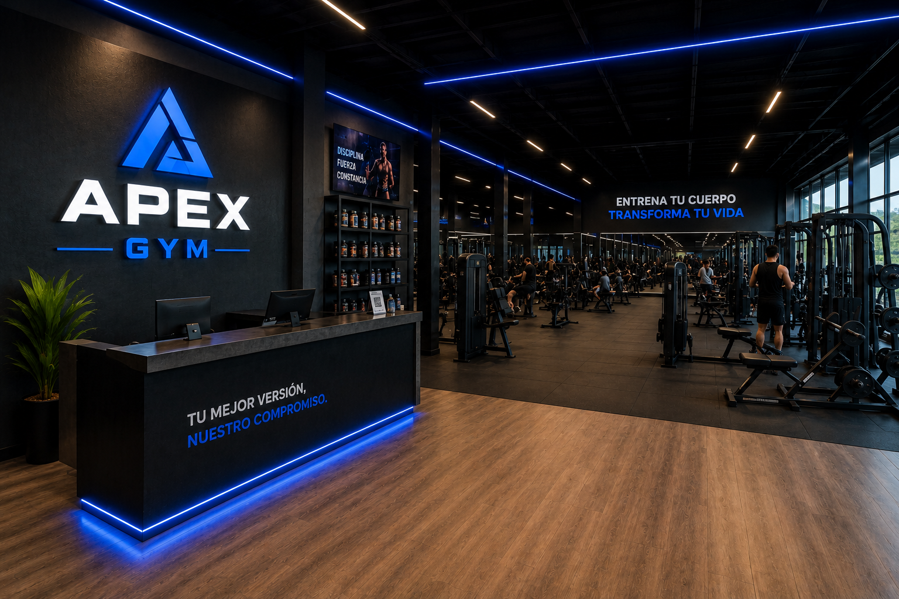

## HISTORIA DE LA EMPRESA

Apex surge como un emprendimiento orientado a promover la actividad física, la salud y el bienestar integral de las personas de la localidad de La Cumbre, Córdoba.

En sus inicios, el gimnasio contaba con una estructura reducida y una administración principalmente manual. Con el crecimiento progresivo de la cantidad de socios y la incorporación de nuevos servicios, comenzaron a evidenciarse limitaciones en la organización de la información y en el control administrativo.

Actualmente, la organización brinda servicios de entrenamiento físico, seguimiento personalizado y rutinas adaptadas a distintos perfiles de usuarios, manteniendo una atención cercana y personalizada.

El crecimiento operativo del gimnasio generó la necesidad de incorporar herramientas tecnológicas que permitan optimizar procesos administrativos, mejorar el control de socios y pagos, y facilitar la gestión integral de la organización.

Misión

Brindar un servicio de entrenamiento físico accesible y de calidad, promoviendo hábitos saludables y el bienestar integral de los socios mediante atención personalizada y seguimiento profesional.

Visión

Convertirse en un gimnasio referente de la región, incorporando tecnología e innovación en sus procesos de gestión y entrenamiento.

Objetivos organizacionales

- Mejorar la calidad del servicio brindado a los socios

- Optimizar la gestión administrativa del gimnasio

- Centralizar la información operativa y financiera

- Incorporar herramientas tecnológicas modernas

- Incrementar la cantidad de socios activos

### Mercado

Servicios ofrecidos

Apex brinda distintos servicios orientados al entrenamiento físico y al bienestar de sus socios:

- Entrenamiento libre en sala

- Rutinas personalizadas

- Seguimiento físico y deportivo

- Entrenamiento funcional

- Asesoramiento básico en hábitos saludables

Clientes

La organización se orienta principalmente a:

- Personas entre 18 y 60 años

- Deportistas recreativos

- Personas interesadas en mejorar su salud física

- Usuarios que buscan descenso de peso o acondicionamiento físico

Proveedores

- Proveedores de equipamiento deportivo

- Servicios de internet y conectividad

- Comercios de suplementación y accesorios fitness

Competidores

La organización posee competencia tanto física como digital:

- Gimnasios locales de la región

- Centros de entrenamiento funcional

- Aplicaciones móviles de entrenamiento

- Plataformas digitales fitness

### Dimensionamiento

Actualmente, Apex posee un promedio aproximado de 100 socios activos mensuales.

Indicadores operativos estimados:

- 60 registros diarios promedio de asistencia

- 25 nuevas inscripciones mensuales

- 90 pagos mensuales registrados

- Horario operativo de 07:00 hs a 22:00 hs

- Atención simultánea de múltiples socios en horarios pico

- Gestión manual de pagos, rutinas y asistencias

La organización presenta un crecimiento sostenido en la cantidad de usuarios y operaciones administrativas, lo cual incrementa la necesidad de contar con herramientas tecnológicas que permitan automatizar procesos y mejorar el control de la información.

## RELEVAMIENTO ESTRUCTURAL

A continuación, se presenta la estructura organizacional correspondiente al gimnasio Apex:

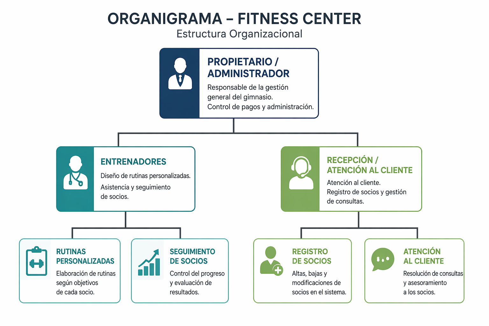

Descripción de las áreas

Administración

Cantidad de personas: 1

Funciones principales:

- Gestión general del gimnasio

- Administración de socios

- Control de pagos y cuotas

- Supervisión de ingresos y egresos

- Organización operativa del establecimiento

Puesto responsable:

- Propietario / Administrador

Área de Entrenamiento

Cantidad de personas: 2

Funciones principales:

- Diseño de rutinas personalizadas

- Seguimiento físico de los socios

- Supervisión de ejercicios

- Asistencia técnica durante entrenamientos

- Evaluación del progreso físico

Puestos:

• Entrenadores

Atención al Cliente y Recepción

Cantidad de personas: 1

Funciones principales:

- Atención al público

- Registro de nuevos socios

- Validación de pagos

- Gestión de consultas

- Control básico de asistencia

Puesto responsable:

- Recepcionista

Estructura organizacional

La organización posee una estructura funcional simple, adecuada al tamaño actual del gimnasio. Las decisiones administrativas y operativas son centralizadas principalmente por el propietario, mientras que las tareas técnicas y de atención al cliente son distribuidas entre entrenadores y recepción.

Actualmente, gran parte de los procesos administrativos son realizados de manera manual o mediante herramientas no integradas, lo que genera dificultades de control y seguimiento de la información.

Relación entre áreas

Las áreas del gimnasio trabajan de manera conjunta e interdependiente. La recepción registra y administra la información inicial de los socios; los entrenadores realizan el seguimiento físico y deportivo; mientras que la administración centraliza el control operativo y financiero de la organización

## RELEVAMIENTO FUNCIONAL

El relevamiento funcional permite identificar y documentar los principales procesos operativos y administrativos de la organización.

A través del análisis de los procesos actuales, se busca comprender cómo circula la información dentro del gimnasio, qué tareas realiza cada área y cuáles son las principales problemáticas derivadas de la gestión manual de datos.

A continuación, se detallan los principales procesos relevados relacionados con el futuro sistema  ForgeFit

## PROCESOS RELEVADOS

1)Proceso de Alta de Socios

Descripción del proceso

El proceso inicia cuando una persona solicita la inscripción al gimnasio. El personal de recepción registra los datos personales del nuevo socio y posteriormente el entrenador asigna una rutina inicial de entrenamiento.

Responsables involucrados:

- Recepcionista

- Entrenador

- Administrador

Actividades principales:

- Registro de datos personales

- Generación del alta del socio

- Asignación de rutina

- Habilitación para acceso al gimnasio

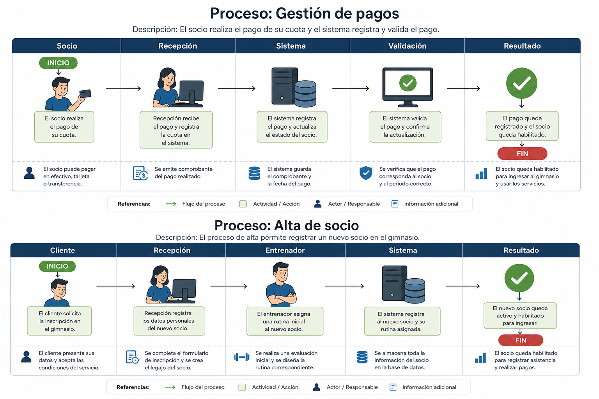

Figura 1 – Alta de Socios

Documentación utilizada

- Formulario de inscripción

- Planillas de registro

- Rutinas personalizadas

2)Proceso de Gestión de Pagos

Descripción del proceso

El proceso de gestión de pagos permite registrar las cuotas mensuales de los socios y validar su estado de habilitación para ingresar al gimnasio.

Actualmente, gran parte del control se realiza manualmente mediante planillas y registros administrativos.

Responsables involucrados

- Recepcionista

- Administración

Actividades principales

- Recepción del pago

- Registro de la cuota

- Validación del estado del socio

- Actualización del estado de acceso

Figura 2 – Gestión de Pagos

Documentación utilizada

- Comprobantes de pago

- Planillas Excel

- Registros manuales

3)Proceso de Registro de Asistencia

##### Descripción del proceso

El proceso de asistencia inicia cuando el socio se presenta en el gimnasio y muestra su código QR personal desde su dispositivo móvil frente al lector del sistema.

La cámara lectora captura automáticamente el código QR y el sistema ForgeFit valida la información del socio, verificando su estado de habilitación y el cumplimiento de sus pagos.

Una vez validada la información, el sistema registra automáticamente la asistencia y habilita el acceso correspondiente.

Responsables involucrados

- Socio

- Recepción

- Sistema  ForgeFit

##### Actividades principales

- Presentación del código QR personal

- Captura automática del código QR mediante cámara lectora

- Validación del estado del socio

- Registro automático de asistencia

- Confirmación de acceso

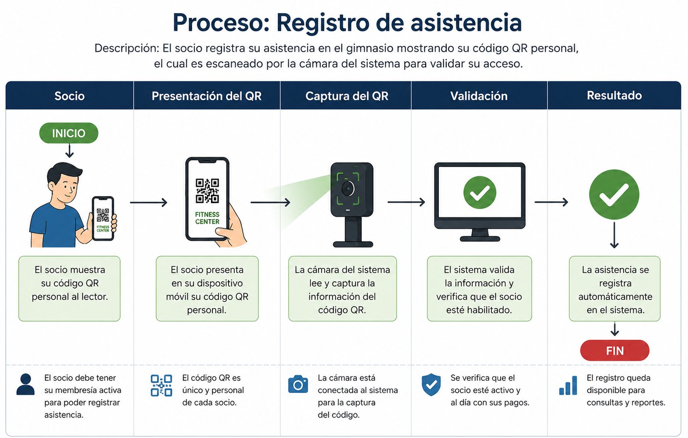

Figura 3 – Registro de Asistencia

##### Documentación utilizada

- Código QR personal del socio

- Registro digital de asistencias

- Base de datos de socios

- Historial de accesos registrados

Conclusión del relevamiento funcional

Los procesos relevados permiten identificar una alta dependencia de tareas manuales y herramientas no integradas, generando dificultades en el control de pagos, seguimiento de socios y organización de la información.

La implementación del sistema  ForgeFit  permitirá centralizar los procesos operativos y administrativos, optimizando tiempos y mejorando la gestión integral del gimnasio.

## RELEVAMIENTO TECNOLÓGICO

El relevamiento tecnológico tiene como objetivo identificar la infraestructura informática y tecnológica actualmente utilizada por la organización, así como también detectar las herramientas y tecnologías que podrían incorporarse para optimizar los procesos administrativos y operativos del gimnasio.

A continuación, se detallan los recursos tecnológicos relevados durante el análisis de la organización.

Hardware

Actualmente, el gimnasio cuenta con equipamiento tecnológico básico destinado principalmente a tareas administrativas y de atención al cliente.

- Equipamiento relevado

- 1 computadora de escritorio utilizada en recepción y administración

- Teléfonos móviles utilizados para comunicación y control operativO

- Router WiFi para conectividad interna

- Impresora multifunción para comprobantes y documentación administrativa 

- Características generales

- Equipos orientados a tareas administrativas básicas

- Utilización compartida entre administración y recepción

- Sin infraestructura de servidor dedicado

- Almacenamiento local de información

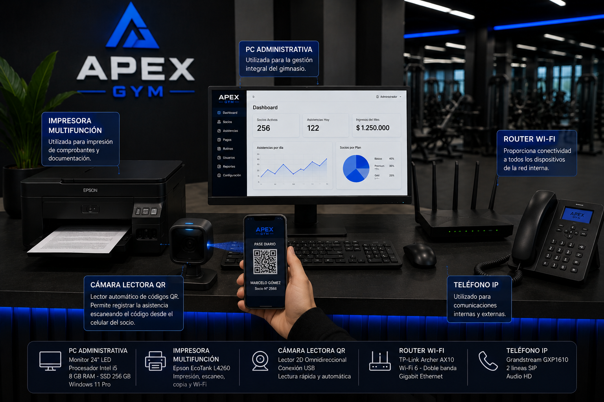

Conectividad

La organización dispone de una red WiFi interna destinada al acceso administrativo y conexión de dispositivos utilizados en la operación diaria.

- Características de conectividad

- Red WiFi local

- Acceso a internet para tareas administrativas

- Conexión compartida entre dispositivos

- Sin segmentación de red

- Topología actual

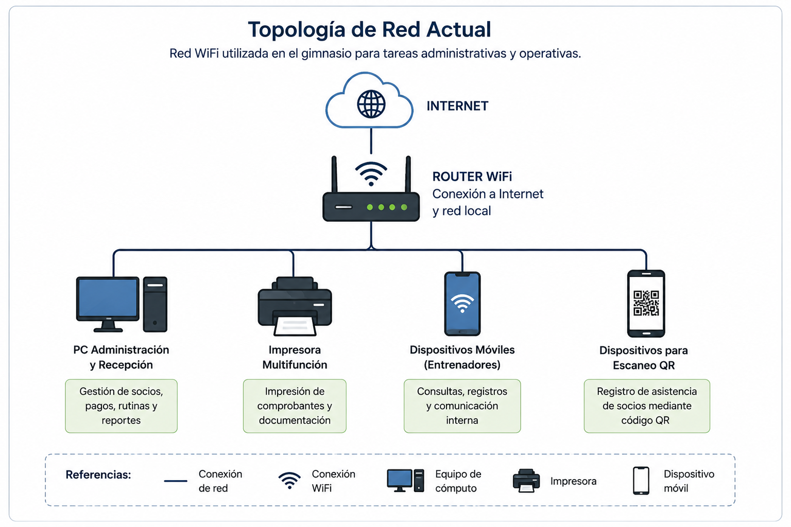

Figura 4 – Topología básica de red utilizada en la organización.

Software utilizado

Actualmente, gran parte de la gestión de la información se realiza mediante herramientas no integradas y procesos manuales.

- Herramientas utilizadas

- Microsoft Excel para control de pagos y socios

- Registros manuales en papel

- WhatsApp para comunicación con socios

- Herramientas básicas de oficina 

- Problemáticas detectadas

- Duplicación de información

- Riesgo de pérdida de datos

- Dificultad para realizar seguimientos

- Escasa automatización de procesos

- Dependencia de registros manuales

Tecnología aplicable

Durante el relevamiento se identificaron distintas tecnologías que podrían incorporarse como parte de la solución informática propuesta.

Tecnologías aplicables al proyecto  ForgeFit

- Sistema web centralizado

- Base de datos relacional

- Gestión de usuarios y roles

- Generación y validación de códigos QR

- Acceso desde múltiples dispositivos

- Panel administrativo

- Posible aplicación móvil futura

- Almacenamiento centralizado de información

Beneficios esperados

- Automatización de procesos administrativos

- Mejora en el control de pagos y asistencias

- Centralización de información

- Reducción de errores manuales

- Optimización del tiempo operativo

- Mejor experiencia para socios y personal

Conclusión del relevamiento tecnológico

El análisis tecnológico realizado permitió identificar que la organización posee una infraestructura informática básica, suficiente para iniciar un proceso de modernización tecnológica mediante una solución web centralizada.

Actualmente existen limitaciones relacionadas con la falta de automatización, almacenamiento centralizado y control integrado de la información, lo cual justifica la implementación del sistema  ForgeFit  como herramienta principal de gestión operativa y administrativa.

La incorporación de nuevas tecnologías permitirá optimizar procesos internos, mejorar la seguridad de la información y brindar una gestión más eficiente y organizada para la organización.

## DIAGNÓSTICO Y PROPUESTA

A partir del relevamiento realizado sobre la organización, se identificaron distintas problemáticas relacionadas principalmente con la gestión manual de información, la falta de integración entre procesos y las limitaciones tecnológicas actuales.

En función de ello, se plantea una propuesta de solución informática orientada a optimizar la administración general del gimnasio mediante la implementación del sistema  ForgeFit.

| DIAGNÓSTICO | PROPUESTA |
| --- | --- |
| La administración manual de socios mediante planillas y registros en papel genera duplicación de información, riesgo de pérdida de datos y dificultades para mantener información actualizada en tiempo real. | Implementación de un sistema web centralizado para la gestión integral de socios. |
| El control manual de pagos dificulta el seguimiento de cuotas, aumenta el riesgo de errores administrativos y limita la generación de reportes financieros confiables. | Desarrollo de un módulo de gestión de cuotas y pagos automatizados. |
| La ausencia de un sistema automatizado de asistencia impide obtener registros precisos de ingresos, dificultando el control operativo y el seguimiento de actividad de los socios. | Registro de asistencia mediante lectura de códigos QR desde dispositivos móviles utilizando lector automático de escritorio. |
| La gestión manual de rutinas dificulta el seguimiento personalizado de los socios y limita la disponibilidad histórica de la información deportiva. | Se contempla como mejora futura la incorporación de un módulo digital de rutinas y seguimiento físico, quedando esta funcionalidad fuera del alcance de la primera versión de ForgeFit |
| La utilización de herramientas no integradas provoca inconsistencias en la información y dificulta la centralización y disponibilidad de los datos operativos. | Centralización de toda la información en una única base de datos relacional. |
| Los procesos administrativos manuales incrementan los tiempos operativos y generan tareas repetitivas que afectan la eficiencia general de la organización. | Automatización de procesos administrativos y generación de reportes digitales. |

Conclusión del diagnóstico

El análisis realizado permitió detectar diversas debilidades relacionadas principalmente con la administración manual de procesos y la falta de herramientas tecnológicas integradas.

La implementación del sistema  ForgeFit  permitirá optimizar la gestión operativa del gimnasio, mejorar el control administrativo y centralizar toda la información en una plataforma moderna, segura y accesible

## PROPUESTA GENERAL

Como solución a las problemáticas detectadas durante el relevamiento realizado, se propone el desarrollo e implementación del sistema web denominado ForgeFit .

El objetivo principal del sistema será optimizar y centralizar la gestión administrativa y operativa del gimnasio, permitiendo mejorar el control de socios, pagos, asistencias y usuarios o.

ForgeFit  será una plataforma web accesible desde distintos dispositivos conectados a la red, diseñada para facilitar el trabajo administrativo y mejorar la experiencia tanto de los empleados como de los socios.

Principales módulos del sistema

- Gestión de socios

- Gestión de pagos y cuotas

- Registro de asistencia mediante código QR.

- Gestión de usuarios y roles

- Reportes administrativos

Beneficios esperados

- Reducción de tareas manuales

- Mayor organización administrativa

- Mejor control de pagos y asistencias

- Acceso rápido y seguro a la información

- Optimización de tiempos operativos

- Mejora en la atención y seguimiento de socios

La implementación de  ForgeFit permitirá modernizar la gestión de la organización mediante herramientas tecnológicas adaptadas a las necesidades actuales del gimnasio.

## 11. MODELO DE REQUERIMIENTOS Y AMBIENTAL

El Modelo de Requerimientos y Ambiental permite establecer las funcionalidades que deberá proporcionar el sistema ForgeFit, determinar sus límites y definir el contexto en el cual interactuará con los diferentes usuarios de la organización.

A partir del relevamiento realizado en el gimnasio Apex, se identificaron las necesidades principales relacionadas con la gestión de socios, pagos, asistencias y rutinas de entrenamiento. Estas necesidades constituyen la base para definir los objetivos, límites y alcance del sistema.

### 11.1 Definición de Objetivos

#### Objetivo General

Desarrollar un sistema web denominado ForgeFit que permita optimizar y centralizar la gestión administrativa y operativa del gimnasio Apex, facilitando la administración de socios, pagos, asistencias y usuarios, con acceso desde distintos dispositivo.

#### Objetivos Específicos

- Centralizar la información de los socios y de los principales procesos del gimnasio en una única base de datos.

- Facilitar el registro, consulta y actualización de la información correspondiente a los socios.

- Mejorar el control y seguimiento de las cuotas y pagos realizados.

- Automatizar el registro de asistencia de los socios mediante la utilización de códigos QR.

- Validar el estado de habilitación de los socios antes de permitir y registrar su ingreso al gimnasio.

- Permitir la utilización del sistema por diferentes tipos de usuarios, estableciendo funcionalidades y permisos de acuerdo con sus responsabilidades.

- Reducir la utilización de registros manuales y la duplicación de información, facilitando el acceso a datos actualizados para la gestión operativa y administrativa del gimnasio.

### 11.2 Límites del Sistema

El sistema ForgeFit estará limitado a la gestión de los procesos directamente relacionados con socios, pagos y cuotas, asistencias y usuarios del gimnasio Apex.

La solución comprenderá únicamente las operaciones necesarias para administrar dichos procesos dentro de la organización. Las actividades pertenecientes a otras áreas de gestión empresarial o servicios complementarios no formarán parte de esta primera versión del sistema.

Quedarán fuera de los límites de ForgeFit:

- La gestión de rutinas y planes de entrenamiento.

- La gestión de proveedores de equipamiento deportivo.

- La compra, mantenimiento y administración de máquinas y elementos del gimnasio.

- La liquidación de sueldos del personal.

- La gestión contable e impositiva de la organización.

- La administración de servicios externos contratados.

- La venta y gestión de stock de suplementos o productos deportivos.

- La administración de otras sucursales o gimnasios.

- El desarrollo de una aplicación móvil independiente durante esta primera etapa.

ForgeFit estará orientado inicialmente a cubrir las necesidades operativas y administrativas del gimnasio Apex ubicado en La Cumbre, Córdoba.

### 11.3 Alcance del Sistema

El sistema ForgeFit abarcará las funcionalidades necesarias para gestionar los principales procesos operativos y administrativos identificados durante el relevamiento del gimnasio Apex.

Dentro de su alcance se incluirán las siguientes funcionalidades:

#### Gestión de Socios

- Registrar nuevos socios.

- Modificar la información de socios existentes.

- Consultar la información de los socios.

- Registrar la baja de un socio.

- Consultar el estado de habilitación de cada socio.

#### Gestión de Pagos y Cuotas

- Registrar los pagos realizados por los socios.

- Consultar el estado de las cuotas.

- Mantener un historial de pagos.

- Utilizar el estado de pago del socio como parte de la validación de su habilitación para ingresar al gimnasio.

#### Registro de Asistencia

- Identificar al socio mediante su código QR personal.

- Capturar y procesar el código QR mediante el dispositivo de lectura disponible.

- Validar el estado del socio.

- Verificar si el socio se encuentra habilitado para ingresar.

- Registrar automáticamente la fecha y hora de ingreso.

- Confirmar o rechazar el acceso según el resultado de la validación.

- Consultar el historial de asistencias registradas.

#### Gestión de Usuarios y Roles

El sistema permitirá trabajar con distintos perfiles de usuario de acuerdo con las responsabilidades existentes dentro de la organización.

Los perfiles contemplados serán:

- Administrador.

- Recepcionista.

- Socio.

Cada usuario tendrá acceso únicamente a las funcionalidades correspondientes a su rol y permisos definidos dentro del sistema.

#### Gestión de la Información

ForgeFit almacenará de manera centralizada la información correspondiente a socios, pagos y asistencias.

La información podrá ser consultada por los usuarios autorizados de acuerdo con los permisos establecidos dentro del sistema.

### 11.4 Lista de Requerimientos

A partir del relevamiento realizado en el gimnasio Apex y de las necesidades detectadas durante el análisis, se identifican los siguientes requerimientos para el sistema ForgeFit.

Los requerimientos se clasifican en requerimientos funcionales, relacionados con las operaciones que deberá realizar el sistema, y requerimientos no funcionales, vinculados con las características generales de funcionamiento de la solución.

#### 11.4.1 Requerimientos Funcionales

RF01 – Registrar socio El sistema deberá permitir registrar un nuevo socio, almacenando sus datos personales y la información necesaria para su identificación dentro del gimnasio.

RF02 – Modificar socio El sistema deberá permitir modificar la información correspondiente a un socio previamente registrado.

RF03 – Consultar socio El sistema deberá permitir consultar los datos y el estado de un socio registrado.

RF04 – Dar de baja socio El sistema deberá permitir registrar la baja de un socio, modificando su estado dentro del sistema sin eliminar su información histórica.

RF05 – Consultar estado del socio El sistema deberá permitir conocer si un socio se encuentra activo y habilitado para utilizar los servicios del gimnasio.

RF06 – Registrar pago El sistema deberá permitir registrar los pagos de cuotas realizados por los socios.

RF07 – Consultar estado de pago El sistema deberá permitir consultar el estado de las cuotas correspondientes a cada socio.

RF08 – Mantener historial de pagos El sistema deberá conservar un historial de los pagos realizados por cada socio.

RF09 – Validar habilitación de ingreso El sistema deberá verificar el estado del socio y su situación de pagos para determinar si se encuentra habilitado para ingresar al gimnasio.

RF10 – Generar o asociar código QR El sistema deberá disponer de un código QR asociado a cada socio para permitir su identificación durante el proceso de ingreso.

RF11 – Leer código QR El sistema deberá permitir capturar y procesar el código QR presentado por el socio mediante el dispositivo de lectura disponible en recepción.

RF12 – Identificar socio mediante QR El sistema deberá identificar al socio correspondiente al código QR leído.

RF13 – Registrar asistencia El sistema deberá registrar automáticamente la asistencia del socio cuando la validación de ingreso resulte satisfactoria.

RF14 – Registrar fecha y hora de ingreso El sistema deberá almacenar la fecha y hora correspondientes a cada asistencia registrada.

RF15 – Confirmar acceso El sistema deberá informar cuando el socio se encuentre autorizado para ingresar al gimnasio.

RF16 – Rechazar acceso El sistema deberá informar cuando el socio no se encuentre habilitado para ingresar.

RF17 – Gestionar usuarios El sistema deberá permitir administrar los usuarios que tendrán acceso a ForgeFit.

RF18 – Gestionar roles El sistema deberá contemplar distintos perfiles de acceso correspondientes a los usuarios definidos para ForgeFit.

RF19 – Controlar permisos de acceso El sistema deberá restringir las funcionalidades disponibles de acuerdo con el rol correspondiente a cada usuario.

RF20 – Autenticar usuario El sistema deberá permitir que los usuarios autorizados ingresen mediante sus credenciales de acceso.

RF21 – Consultar asistencias El sistema deberá permitir consultar los registros históricos de asistencia de los socios.

RF22 – Consultar reportes administrativos El sistema deberá permitir al Administrador consultar información consolidada relacionada con socios, pagos y asistencias.

#### 11.4.2 Requerimientos No Funcionales

RNF01 – Sistema Web

ForgeFit deberá funcionar como una aplicación web accesible mediante un navegador.

RNF02 – Acceso desde múltiples dispositivos

El sistema deberá poder utilizarse desde distintos dispositivos que dispongan de acceso a la red y un navegador compatible.

RNF03 – Acceso simultáneo

El sistema deberá permitir la utilización simultánea por parte de múltiples usuarios autorizados.

RNF04 – Base de datos centralizada

La información del sistema deberá almacenarse en una base de datos centralizada para evitar la dispersión y duplicación de registros.

RNF05 – Seguridad de acceso

El acceso a las funcionalidades del sistema deberá estar protegido mediante identificación de usuarios y control de permisos según roles.

RNF06 – Integridad de la información

El sistema deberá mantener la consistencia de los datos almacenados y evitar modificaciones no autorizadas.

RNF07 – Disponibilidad de la información

Los usuarios autorizados deberán poder acceder a la información necesaria para realizar sus tareas dentro del horario operativo del gimnasio.

RNF08 – Facilidad de uso

Las interfaces deberán presentar una estructura clara y comprensible para facilitar su utilización por parte del personal y los socios.

RNF09 – Compatibilidad con lectura QR

El sistema deberá permitir la utilización de un dispositivo con cámara o lector compatible para capturar los códigos QR utilizados en el registro de asistencia.

RNF10 – Trazabilidad

El sistema deberá conservar información histórica suficiente para consultar pagos y asistencias previamente registrados.

## 12. MODELO DE CASO DE USO AMBIENTAL

El Modelo de Caso de Uso Ambiental permite representar de manera general la interacción entre el sistema ForgeFit y los actores externos que participan en los procesos de la organización.

Este modelo representa las principales funcionalidades ofrecidas por el sistema sin profundizar en el funcionamiento interno de cada módulo.

Los actores identificados para ForgeFit son: Administrador, Recepcionista y Socio.

### 12.1 Descripción de Actores

#### Administrador

El Administrador es el usuario responsable de la gestión general del gimnasio y posee el mayor nivel de acceso dentro del sistema.

Entre sus principales interacciones con el sistema se encuentran:

- Gestionar socios.

- Registrar y consultar pagos.

- Consultar asistencias.

- Gestionar usuarios y roles.

- Consultar reportes administrativos.

- Supervisar la información general del sistema.

#### Recepcionista

El Recepcionista es el usuario encargado principalmente de la atención al público y del registro de operaciones relacionadas con los socios.

Entre sus principales funciones se encuentran:

- Registrar nuevos socios.

- Consultar y modificar información de socios.

- Registrar pagos.

- Consultar el estado de las cuotas.

- Controlar el ingreso de los socios.

- Consultar el estado de habilitación.

- Consultar registros de asistencia.

#### Socio

El Socio representa al cliente registrado dentro del gimnasio Apex.

Su interacción con ForgeFit se encuentra relacionada principalmente con el proceso de ingreso al establecimiento.

Entre sus principales funciones se encuentran:

- Identificarse mediante su código QR personal.

- Solicitar el ingreso al gimnasio.

Durante el proceso de ingreso, ForgeFit verificará automáticamente el estado del socio y determinará si se encuentra habilitado para acceder.

### 12.2 Casos de Uso Ambientales

A nivel ambiental se identifican los siguientes casos de uso principales:

- Gestionar Socios.

- Gestionar Pagos.

- Registrar Asistencia.

- Consultar Asistencias.

- Gestionar Usuarios y Roles.

- Consultar Reportes Administrativos

.

### 12.3 Diagrama de Caso de Uso Ambiental

El siguiente diagrama representa las interacciones entre los actores externos y las principales funcionalidades del sistema ForgeFit, permitiendo visualizar de manera general el alcance funcional del sistema y la participación de cada tipo de usuario.

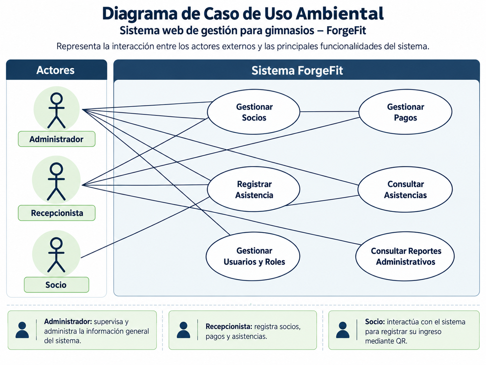

## 13. Modelo de Paquetes

El Modelo de Paquetes permite representar la organización funcional del sistema ForgeFit, agrupando las funcionalidades relacionadas en distintos módulos y mostrando las principales dependencias existentes entre ellos.

El sistema se encuentra organizado en los paquetes Gestión de Socios, Gestión de Pagos, Registro de Asistencia, Gestión de Usuarios y Roles y Reportes Administrativos.

Las dependencias entre los paquetes reflejan la utilización de información proveniente de otros módulos para completar los distintos procesos del sistema. Por ejemplo, la gestión de pagos y el registro de asistencia requieren información del socio, mientras que los reportes administrativos consolidan información proveniente de socios, pagos y asistencias.

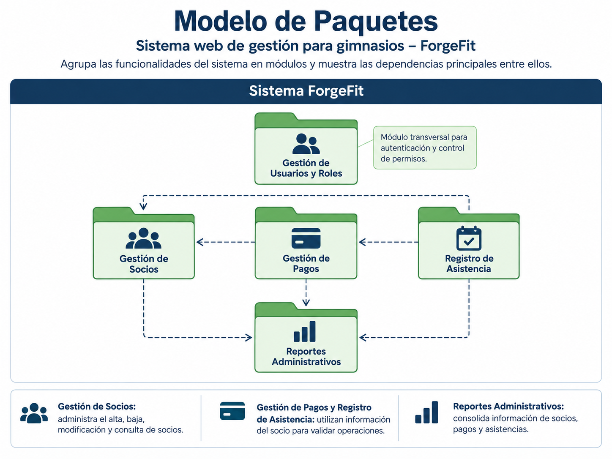

## 14. Árbol de Casos de Uso

El Árbol de Casos de Uso permite representar de manera jerárquica las principales funcionalidades del sistema ForgeFit, agrupando los casos de uso según el módulo al que pertenecen.

Esta representación facilita la visualización de la estructura funcional general del sistema, mostrando la relación entre ForgeFit, sus módulos principales y los casos de uso asociados a cada uno.

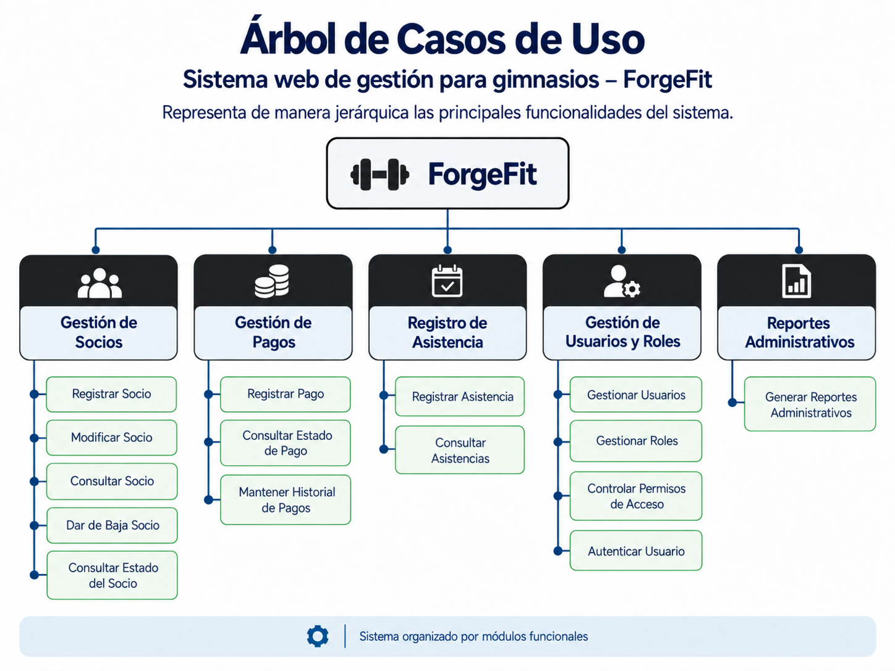

## 15. Desarrollo del paquete “Registro de Asistencia”

El paquete Registro de Asistencia comprende las funcionalidades necesarias para controlar y registrar el ingreso de los socios al gimnasio Apex.

El proceso comienza cuando el socio presenta su código QR personal frente al dispositivo de lectura. A partir de esta identificación, el sistema ForgeFit verifica la información del socio, su estado de habilitación y su situación de pagos. Si la validación resulta satisfactoria, el sistema registra automáticamente la asistencia junto con la fecha y hora correspondientes.

Además del registro de ingreso, el módulo permite consultar posteriormente el historial de asistencias almacenadas, facilitando el control operativo y el seguimiento de la actividad de los socios.

Para el desarrollo detallado del paquete se analizarán los casos de uso Registrar Asistencia y Consultar Asistencias.

### 15.1 Diagrama de Caso de Uso del Paquete

El Diagrama de Caso de Uso del paquete Registro de Asistencia representa las principales funcionalidades relacionadas con el control de ingreso de los socios al gimnasio y los actores que interactúan con ellas.

El paquete contempla los casos de uso Registrar Asistencia y Consultar Asistencias.

El Socio participa en el proceso de registro de su ingreso mediante la presentación de su código QR personal. El Recepcionista interviene en el control operativo del proceso de ingreso y puede consultar los registros de asistencia almacenados. Por su parte, el Administrador puede consultar el historial de asistencias para realizar tareas de supervisión y control.

Las operaciones necesarias para leer el código QR, identificar al socio, validar su estado, verificar su situación de pagos y almacenar la fecha y hora del ingreso forman parte del caso de uso Registrar Asistencia.

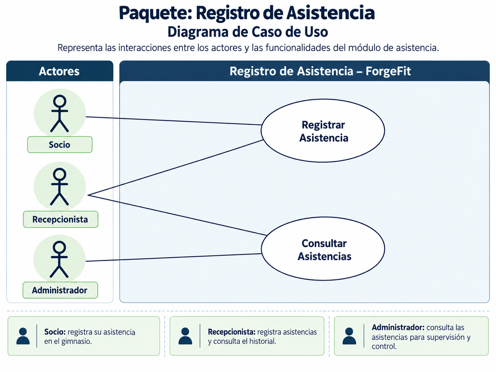

### 15.2 Diagrama de Clases del Paquete

El Diagrama de Clases del paquete Registro de Asistencia representa las principales clases que intervienen en el proceso de identificación, validación, registro y consulta de las asistencias de los socios.

La clase Socio contiene la información necesaria para identificar al miembro del gimnasio mediante su código QR y conocer su estado dentro del sistema. La clase Pago permite consultar la situación de las cuotas del socio, información necesaria para determinar si se encuentra habilitado para ingresar. Finalmente, la clase Asistencia representa cada ingreso registrado, almacenando la fecha y hora correspondientes.

Para organizar las responsabilidades del módulo también se incorporan clases de interfaz, control y persistencia. La clase InterfazRegistroAsistencia representa el punto de interacción con el proceso de lectura del código QR y con la consulta de registros. La clase ControlAsistencia coordina la lógica necesaria para identificar al socio, validar su estado, verificar su situación de pagos y registrar o consultar las asistencias.

Las clases RepositorioSocio, RepositorioPago y RepositorioAsistencia se encargan de acceder y gestionar la información correspondiente a las entidades del dominio.

Dentro del modelo, un Socio puede poseer múltiples registros de Pago y múltiples registros de Asistencia a lo largo del tiempo, mientras que cada pago y cada asistencia pertenecen a un único socio.

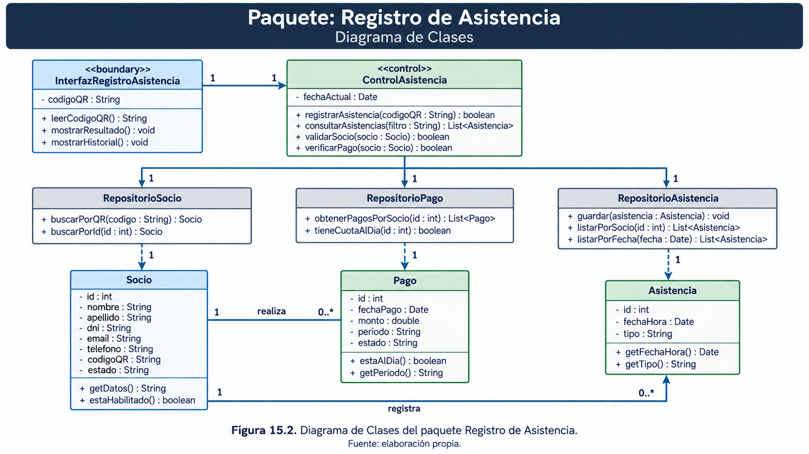

### 15.4 Caso de Uso “Registrar Asistencia”

#### 15.3.1 Prototipo de Interfaz

El prototipo de interfaz correspondiente al caso de uso Registrar Asistencia representa la pantalla utilizada durante el proceso de ingreso de los socios al gimnasio.

La interfaz permite capturar el código QR personal del socio mediante el dispositivo de lectura disponible. Una vez identificado el socio, ForgeFit muestra información básica relacionada con su estado y situación de pago.

Luego de realizar las validaciones correspondientes, el sistema informa de manera visual si el ingreso fue autorizado o rechazado. Cuando el acceso es autorizado, la asistencia se registra automáticamente junto con la fecha y hora del ingreso.

[INSERTAR AQUÍ EL PROTOTIPO DE INTERFAZ]

Figura X. Prototipo de interfaz del caso de uso Registrar Asistencia.  Fuente: elaboración propia.

#### 15.3.2 Ficha del Caso de Uso “Registrar Asistencia”

La ficha del caso de uso Registrar Asistencia documenta de manera detallada el comportamiento esperado del sistema durante el proceso de ingreso de un socio al gimnasio, especificando los actores participantes, las condiciones previas, el flujo principal, las situaciones alternativas y los resultados obtenidos.

| Campo | Descripción |
| --- | --- |
| Código | CU-RA-01 |
| Nombre | Registrar Asistencia |
| Paquete | Registro de Asistencia |
| Actor principal | Socio |
| Actor secundario | Recepcionista |
| Objetivo | Registrar automáticamente el ingreso de un socio al gimnasio luego de identificarlo mediante su código QR y verificar que se encuentre habilitado. |
| Descripción | El socio presenta su código QR personal. ForgeFit identifica al socio, verifica su estado y su situación de pagos y, si se encuentra habilitado, registra la asistencia junto con la fecha y hora del ingreso. |
| Precondiciones | El socio debe encontrarse registrado en ForgeFit, poseer un código QR asociado y el sistema debe disponer del dispositivo de lectura correspondiente. |
| Disparador | El socio presenta su código QR frente al lector del sistema. |
| Postcondición exitosa | La asistencia queda registrada con el socio, la fecha y la hora correspondientes y el sistema confirma el acceso. |
| Postcondición alternativa | La asistencia no se registra y el sistema informa que el ingreso no se encuentra autorizado. |

#### Flujo Principal

- El socio presenta su código QR personal frente al dispositivo de lectura.

- El sistema captura y procesa el código QR.

- ForgeFit identifica al socio asociado al código.

- El sistema consulta el estado del socio.

- El sistema verifica su situación de pagos.

- ForgeFit determina si el socio se encuentra habilitado para ingresar.

- El sistema genera un nuevo registro de asistencia.

- Se almacenan automáticamente la fecha y la hora del ingreso.

- ForgeFit informa que el acceso fue autorizado.

#### Flujos Alternativos

A1 – Código QR no reconocido Si el código QR no corresponde a ningún socio registrado, el sistema informa que el código no es válido y no registra la asistencia.

A2 – Socio no habilitado Si el socio se encuentra inactivo o no habilitado, ForgeFit rechaza el acceso y no registra la asistencia.

A3 – Situación de pago irregular Si el socio no cumple con las condiciones de pago necesarias para ingresar, el sistema informa que el acceso fue rechazado y no registra la asistencia.

A4 – Error en la lectura del código QR Si el dispositivo no puede procesar correctamente el código QR, el sistema informa el error y solicita realizar nuevamente la lectura.

#### 15.3.3 Diagrama de Asociaciones

El Diagrama de Asociaciones correspondiente al caso de uso Registrar Asistencia representa las clases y objetos que participan en el proceso de registro de ingreso de un socio al gimnasio.

La interacción comienza en la clase InterfazRegistroAsistencia, encargada de recibir la lectura del código QR y mostrar el resultado del proceso. Esta interfaz se comunica con ControlAsistencia, responsable de coordinar la lógica del caso de uso.

El controlador consulta la información necesaria mediante RepositorioSocio, RepositorioPago y RepositorioAsistencia. A través de estos repositorios se accede a las entidades Socio, Pago y Asistencia, necesarias para identificar al socio, verificar su situación y registrar finalmente el ingreso.

Las asociaciones principales del caso de uso son las siguientes:

- InterfazRegistroAsistencia se asocia con ControlAsistencia.

- ControlAsistencia se asocia con RepositorioSocio.

- ControlAsistencia se asocia con RepositorioPago.

- ControlAsistencia se asocia con RepositorioAsistencia.

- RepositorioSocio accede a Socio.

- RepositorioPago accede a Pago.

- RepositorioAsistencia accede a Asistencia.

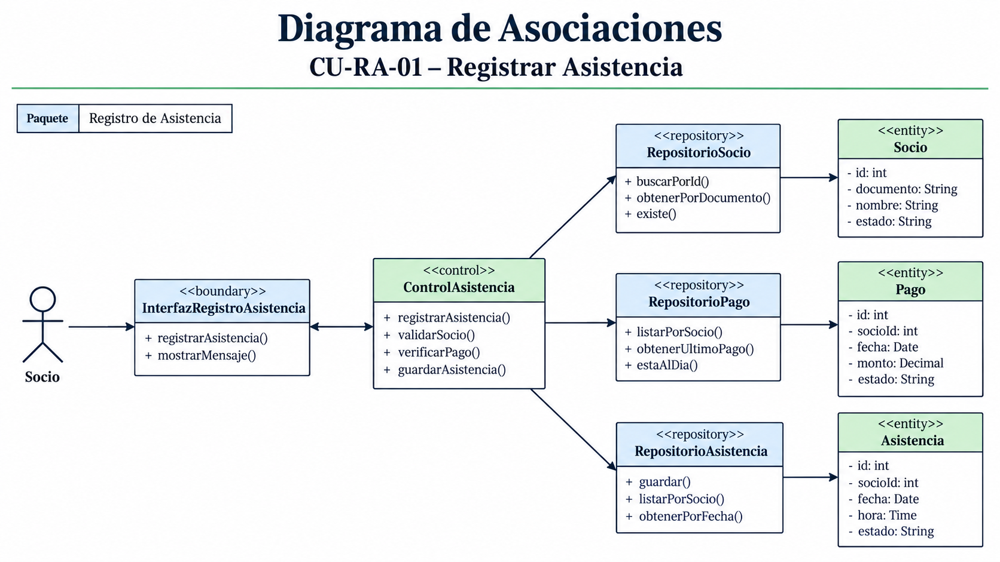

#### 15.3.4 Diagrama de Colaboración

El Diagrama de Colaboración correspondiente al caso de uso Registrar Asistencia representa la secuencia de mensajes que se intercambian entre los distintos objetos que participan durante el proceso de ingreso de un socio al gimnasio.

El proceso comienza cuando el Socio presenta su código QR frente a la InterfazRegistroAsistencia. La interfaz envía la información al ControlAsistencia, encargado de coordinar la lógica del caso de uso.

El controlador consulta el RepositorioSocio para identificar al socio correspondiente al código QR, valida su estado y luego consulta el RepositorioPago para verificar la situación de sus cuotas. Si el socio se encuentra habilitado, el sistema genera el registro de asistencia y utiliza el RepositorioAsistencia para almacenarlo.

Finalmente, el resultado del proceso retorna a la interfaz, que informa al socio si el acceso fue autorizado o rechazado.

Los principales mensajes intercambiados durante el proceso son:

- presentarQR()

- leerCodigoQR()

- registrarAsistencia(codigoQR)

- buscarPorQR(codigoQR)

- validarSocio(socio)

- verificarPago(socio)

- obtenerUltimoPago()

- guardar(asistencia)

- mostrarResultado()

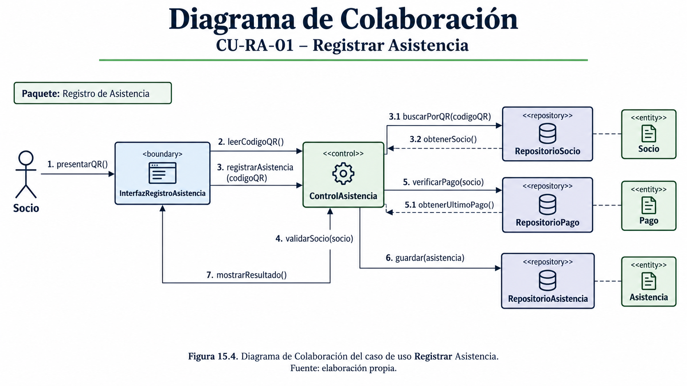

### 15.4 Caso de Uso “Consultar Asistencias”

#### 15.4.1 Prototipo de Interfaz

El prototipo de interfaz correspondiente al caso de uso Consultar Asistencias representa la pantalla mediante la cual los usuarios autorizados podrán visualizar los registros históricos de ingreso de los socios al gimnasio.

La interfaz permitirá consultar las asistencias registradas, mostrando información correspondiente al socio, la fecha y la hora de ingreso.

[INSERTAR AQUÍ EL PROTOTIPO DE INTERFAZ]

Figura X. Prototipo de interfaz del caso de uso Consultar Asistencias. Fuente: elaboración propia.

#### 15.4.2 Ficha del Caso de Uso “Consultar Asistencias”

La ficha del caso de uso Consultar Asistencias documenta el comportamiento esperado del sistema durante la consulta de los registros históricos de ingreso de los socios, permitiendo que los usuarios autorizados accedan a la información almacenada en ForgeFit.

| Campo | Descripción |
| --- | --- |
| Código | CU-RA-02 |
| Nombre | Consultar Asistencias |
| Paquete | Registro de Asistencia |
| Actor principal | Recepcionista |
| Actor secundario | Administrador |
| Objetivo | Consultar los registros históricos de asistencia almacenados en ForgeFit para realizar el control y seguimiento de los ingresos de los socios. |
| Descripción | El usuario autorizado accede a la consulta de asistencias. ForgeFit recupera los registros almacenados y presenta la información correspondiente a las asistencias registradas, incluyendo el socio, la fecha y la hora del ingreso. |
| Precondiciones | El usuario debe encontrarse autenticado en ForgeFit y poseer permisos para consultar los registros de asistencia. |
| Disparador | El usuario selecciona la opción Consultar Asistencias. |
| Postcondición exitosa | El sistema muestra los registros de asistencia disponibles para su consulta. |
| Postcondición alternativa | El sistema informa que no existen registros de asistencia disponibles para mostrar. |

#### Flujo Principal

- El Recepcionista o Administrador selecciona la opción Consultar Asistencias.

- El sistema solicita los registros de asistencia almacenados.

- ForgeFit recupera la información correspondiente a las asistencias registradas.

- El sistema presenta los registros encontrados.

- Para cada asistencia se muestra la información correspondiente al socio, fecha y hora del ingreso.

- El usuario visualiza la información y finaliza la consulta.

#### Flujos Alternativos

A1 – No existen asistencias registradas Si no existen registros de asistencia almacenados, ForgeFit informa al usuario que no hay asistencias disponibles para consultar.

A2 –Error al recuperar los registros Si se produce un inconveniente al acceder a la información almacenada, el sistema informa que no fue posible obtener los registros de asistencia.

#### 15.4.3 Diagrama de Asociaciones

El Diagrama de Asociaciones correspondiente al caso de uso Consultar Asistencias representa las clases y objetos que participan durante el proceso de consulta de los registros históricos de asistencia almacenados en ForgeFit.

La interacción comienza en la clase InterfazRegistroAsistencia, desde la cual el usuario solicita visualizar las asistencias registradas. Esta interfaz se comunica con ControlAsistencia, responsable de coordinar la lógica correspondiente a la consulta.

El controlador utiliza RepositorioAsistencia para acceder a los registros de asistencia almacenados. Cada registro se encuentra representado por la entidad Asistencia y se relaciona con un Socio, permitiendo identificar a qué socio corresponde cada ingreso registrado.

#### Asociaciones principales

- Recepcionista se asocia con InterfazRegistroAsistencia.

- Administrador se asocia con InterfazRegistroAsistencia.

- InterfazRegistroAsistencia se asocia con ControlAsistencia.

- ControlAsistencia se asocia con RepositorioAsistencia.

- RepositorioAsistencia accede a Asistencia.

- Asistencia se relaciona con Socio.

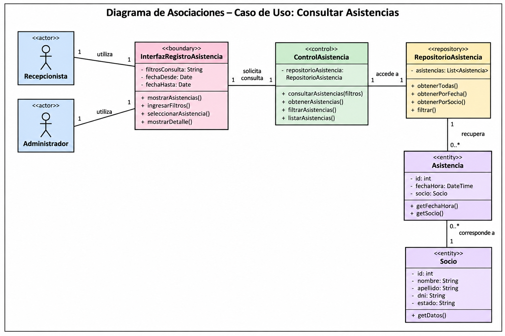

Figura 15.X. Diagrama de Asociaciones del caso de uso Consultar Asistencias. Fuente: elaboración propia.

#### 15.4.4 Diagrama de Colaboración

El Diagrama de Colaboración correspondiente al caso de uso Consultar Asistencias representa la interacción entre los objetos que participan en la recuperación y visualización de los registros históricos de asistencia.

El proceso comienza cuando el Recepcionista o Administrador solicita consultar las asistencias desde la interfaz del sistema. La solicitud es enviada a ControlAsistencia, que coordina el proceso y solicita a RepositorioAsistencia los registros almacenados.

El repositorio recupera las entidades Asistencia y la información del Socio asociado a cada registro. Finalmente, los datos obtenidos son devueltos al controlador y presentados al usuario mediante la interfaz.

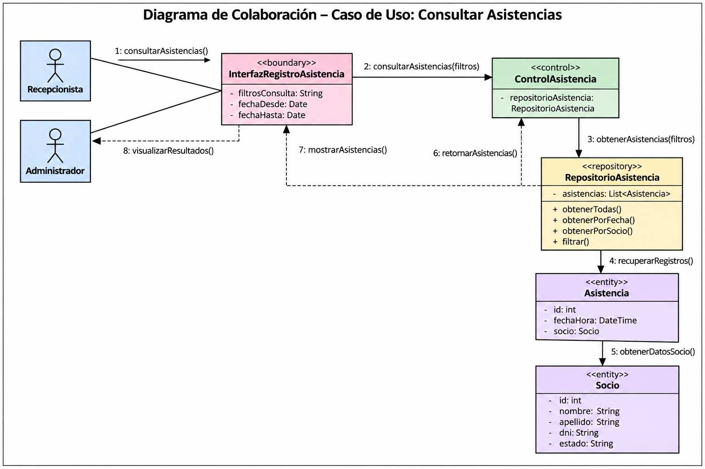

Figura 15.X. Diagrama de Colaboración del caso de uso Consultar Asistencias. Fuente: elaboración propia.

### 15.5 Diagrama de Estados de la Clase Principal

Para el paquete Registro de Asistencia se considera como clase principal a Asistencia, debido a que representa el registro generado durante el proceso de ingreso de un socio al gimnasio.

El Diagrama de Estados permite representar los distintos estados por los que puede atravesar una asistencia durante el proceso de identificación, validación y registro del ingreso.

El ciclo comienza cuando el socio presenta su código QR y ForgeFit inicia el proceso de validación. Si las condiciones de ingreso se cumplen, la asistencia queda registrada con la fecha y hora correspondientes. En caso contrario, el proceso finaliza sin generar el registro de asistencia.

#### Estados

En validación: el sistema está verificando la información necesaria para determinar si corresponde autorizar el ingreso.

Pendiente de registro: la validación fue satisfactoria y el sistema se encuentra en condiciones de generar el registro.

Registrada: la asistencia fue almacenada correctamente con el socio, fecha y hora correspondientes.

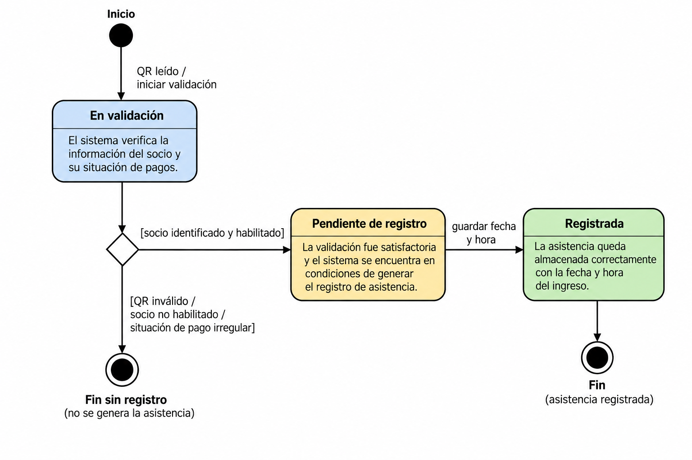

Figura X. Diagrama de Estados de la clase Asistencia. Fuente: elaboración propia.

## GLOSARIO

- Base de datos: conjunto organizado de información almacenada digitalmente.

- Código QR: código de respuesta rápida utilizado para registrar asistencia de socios.

- Gestión de socios: administración de información correspondiente a los clientes del gimnasio.

- Módulo: conjunto de funcionalidades específicas dentro del sistema.

- Plataforma web: sistema accesible mediante navegador y conexión a internet o red local.

- Registro de asistencia: proceso mediante el cual se controla el ingreso de socios al gimnasio.

- Rutina personalizada: planificación de ejercicios diseñada para un socio específico.

- Sistema centralizado: solución informática donde toda la información se almacena en un único entorno.

- Usuario administrador: perfil con permisos de gestión general del sistema

- Usuario entrenador: perfil destinado a la gestión de rutinas y seguimiento físico.

- Usuario socio: perfil utilizado por los clientes del gimnasio.

